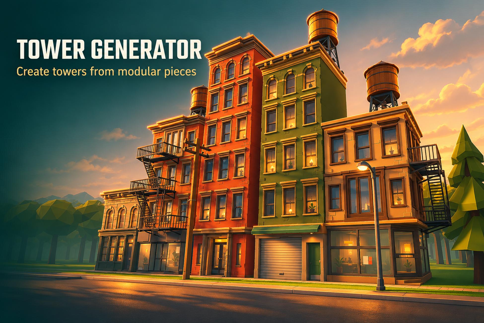
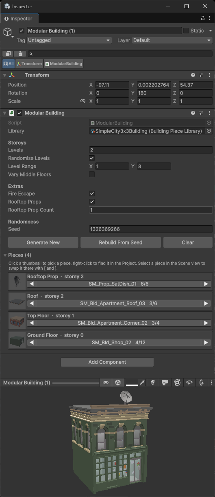

# Tower Generator

Tower Generator is a tool designed to rapidly create modular city tower buildings by assembling prefab pieces including ground floors, mid floors, roofs, fire escapes, and rooftop decor. Originally optimized for Synty’s Polygon City pack, it also supports any modular prefab sets with a similar structure, enabling fast iteration and regeneration of building designs.

---

## Features

- **Modular Prefab Assembly**  
  Automatically constructs towers by stacking prefab pieces categorized as ground floors, mid floors, roofs, fire escapes, and rooftop decor.

- **Automatic Prefab Categorization**  
  Scans your project library and suggests prefab categories to efficiently organize and manage building pieces.

- **One-Click Tower Generation and Regeneration**  
  Generate complete towers easily and quickly iterate variations using the regenerate function.

- **Supports Custom Modular Prefabs**  
  Compatible with Synty’s Polygon City pack and other similar modular building prefab sets.

- **Material Alternatives and Color Controls**  
  Supports multiple material alternatives per building piece and offers per-component color controls (left, right, and random) for visual variation.

---

## Target Audience

- Hobbyists and indie developers populating city scenes efficiently.
- Users of Synty Assets seeking streamlined building assembly workflows.
- Level designers needing rapid prototyping and iteration of tower buildings.

---

## Benefits

- **Save Time:** Automates prefab placement to eliminate manual stacking.
- **Fast Iteration:** Quickly regenerate tower designs to explore architectural variations.
- **Flexible Workflow:** Customize your prefab library by adding or removing pieces at any time.
- **Visual Diversity:** Add multiple material variations to pieces and use color controls to diversify tower appearance without altering models.

---

## Installation

1. Import the Tower Generator package into your Unity project.
2. Open the **Library Builder** window from the Unity Editor menu:  
   **Tools > Tower Generator > Library Builder**  
3. Allow the tool to scan and categorize your prefab library automatically.
4. Customize your prefab collection by adding or removing pieces as needed.

---

## Usage

### Building Piece Categories

Tower Generator organizes prefab pieces into these categories (defined by the `BuildingPieceCategory` enum):

- Ground Floor  
- Mid Floor  
- Roof  
- Fire Escape  
- Roof Decor  

These categories determine stacking logic to assemble coherent towers.

### Adding Material Alternatives

You can add multiple material alternatives to each building piece in your prefab library. This enables the `ModularBuilding` component to randomly or selectively apply different materials at generation, increasing visual variety without changing the underlying geometry.

To add material alternatives:

1. Select your `BuildingPieceLibrary` asset in the Project window.
2. In the Inspector, expand each building piece entry.
3. Add or assign alternative materials as needed.

### Color Controls in ModularBuilding Component

The `ModularBuilding` component includes controls for adjusting material colors on generated towers:

- **Colour Left**: Applies a color variation to the left side materials.
- **Colour Right**: Applies a color variation to the right side materials.
- **Colour Random**: Applies random colors across materials for additional variation.

These buttons enable quick, visual customization of towers at generation and regeneration time.

### Creating and Placing a Tower

1. Open the **Library Builder** window and generate or update your prefab library asset with categorized building pieces.
2. Select and edit this prefab library asset anytime in the Project window to add or remove building pieces or material alternatives.
3. To place a tower in the scene, right-click in the **Hierarchy** window and select:  
   **Tower Generator > Modular Building**  
   This creates a GameObject with the `ModularBuilding` component.
4. Select the newly created GameObject, then use the **Generate Tower** button in the `ModularBuilding` component inspector to create the tower.
5. Use the **Regenerate** button to quickly produce new tower variations without modifying the library.
6. Use the **Colour Left**, **Colour Right**, and **Colour Random** buttons in the `ModularBuilding` inspector to apply color variations to the tower materials.

### Editing the Prefab Library

Manage your prefab pieces and material alternatives via the **Library Builder** editor window or by selecting the `BuildingPieceLibrary` asset in the Project window. Add, remove, or reorganize pieces and material options to tailor the building styles and appearance.

---

## API Overview

- **BuildingPieceCategory (enum)**  
  Enumerates prefab piece types: ground floor, mid floor, roof, fire escape, roof decor.

- **BuildingPieceCategoryExtensions (class)**  
  Provides helper methods for category-related operations.

- **BuildingPieceLibrary (class)**  
  A `ScriptableObject` managing collections of building piece prefabs and their material alternatives.

- **BuildingPieceSlot (struct)**  
  Defines individual slots for building pieces within a tower assembly.

- **ModularBuilding (class)**  
  MonoBehaviour responsible for assembling towers at runtime or within the editor, including material application and color controls.

- **Editor Tools**  
  - `BuildingPieceLibraryEditor` – Custom inspector for prefab library management.  
  - `LibraryBuilderWindow` – EditorWindow for building and editing prefab libraries.  
  - `ModularBuildingEditor` – Custom inspector for the ModularBuilding component.

---

## Recommended Complementary Assets

- **Editor Tools - Developer Essentials**  
  An editor toolkit designed to accelerate development workflows.  
  [Publisher page on Asset Store](https://assetstore.unity.com/packages/package/382386)

---

## Support and Resources

- Visit the [official website](https://chrisburns.com.au) for detailed information.  
- Join the [support Discord server](https://discord.com/invite/ajDgWPmSBS) for community help and updates.  
- Explore more assets by the publisher on the [Unity Asset Store](https://assetstore.unity.com/publishers/36542).

---

## Getting Started

To start using Tower Generator:

1. **Build Your Prefab Library**  
   Open **Library Builder** via **Tools > Tower Generator > Library Builder**. The tool scans your project and suggests prefab categories for your modular building pieces. Save the generated `BuildingPieceLibrary` asset.

2. **Customize Your Library**  
   Select the prefab library asset in the Project window and add or remove pieces and assign material alternatives as needed by editing its contents in the Inspector.

3. **Add a Modular Building to Your Scene**  
   Right-click in the Hierarchy and select **Tower Generator > Modular Building**. This creates a GameObject with the `ModularBuilding` component.

4. **Generate Your Tower**  
   With the Modular Building GameObject selected, use the **Generate Tower** button in its inspector to assemble the tower based on your prefab library.

5. **Apply Material Colors**  
   Use the **Colour Left**, **Colour Right**, and **Colour Random** buttons to adjust the material coloration on your tower as desired.

6. **Iterate Designs Quickly**  
   Use the **Regenerate** button to create variations swiftly without rebuilding the library.

This workflow enables fast creation, visual customization, and iteration of modular towers, streamlining level design and prototyping.

---

Explore the usage instructions above to integrate Tower Generator into your city-building workflow. Quickly generate and regenerate towers, apply material variations, and use color controls to accelerate level design and experiment with architectural styles.

[View Tower Generator on the Unity Asset Store](https://assetstore.unity.com/publishers/36542)

---

For questions or assistance, please join the [support Discord](https://discord.com/invite/ajDgWPmSBS) or visit the [chrisburns.com.au](https://chrisburns.com.au).